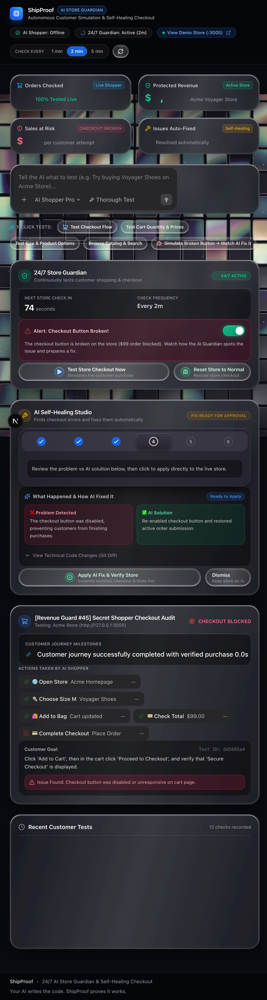
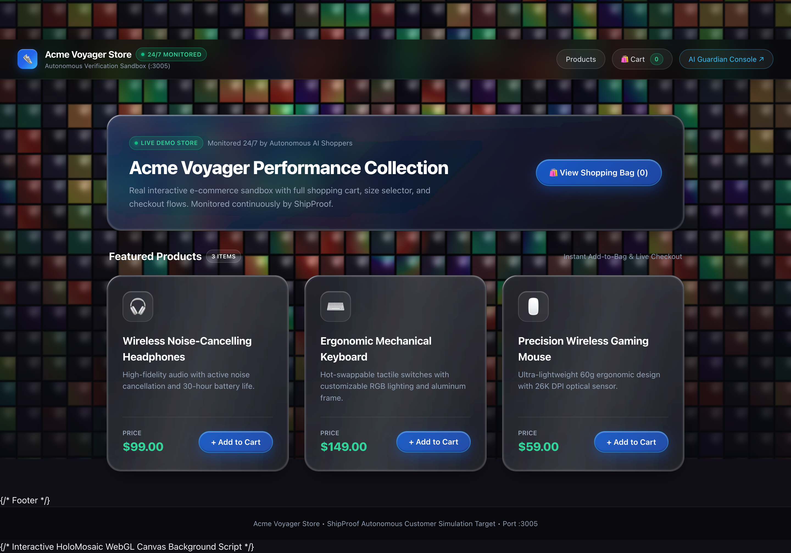
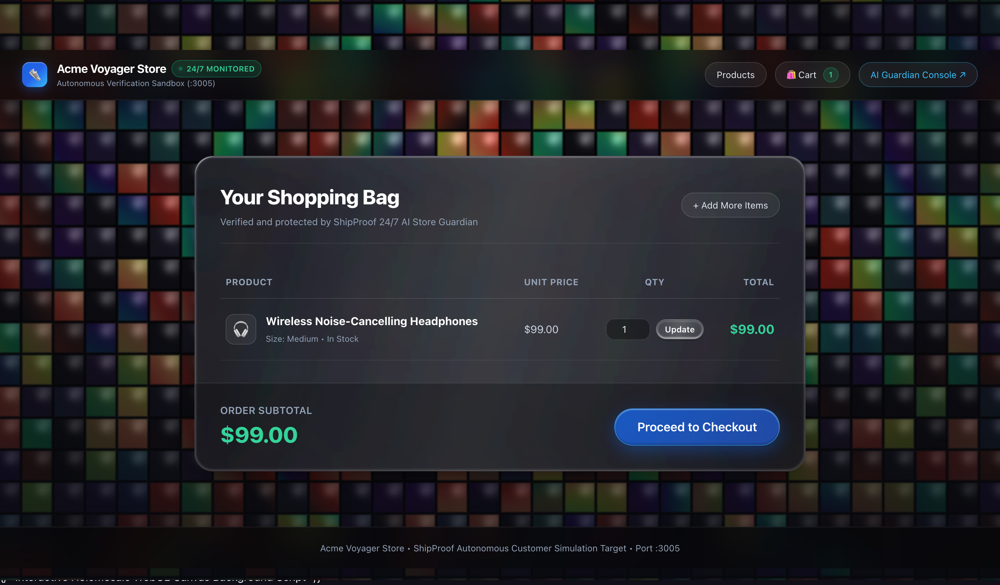
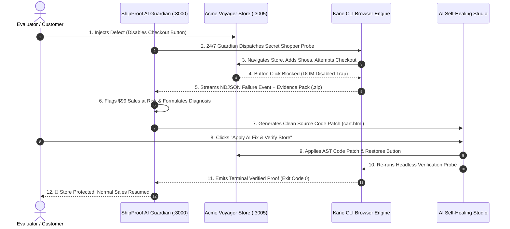

<div align="center">

# 🛡️ ShipProof
### **Autonomous 24/7 AI Store Guardian & Closed-Loop Self-Healing Platform**

> **Your AI writes the code. ShipProof proves it works.**

[](https://kaneclihack.sh)
[-10b981?style=for-the-badge&logo=pytest)](file:///Users/pratham/Projects/ShipProof/pipeline_verification_report.md)
[](frontend/)
[](backend/)
[](frontend/)
[](LICENSE)

[Live Demo Walkthrough](#-30-second-judge-guided-walkthrough) • [Architecture](#-closed-loop-architecture) • [Kane CLI Engine](#-kane-cli-execution-engine) • [Quickstart](#-quickstart-guide) • [Security & Rigor](#-engineering--security-rigor)

</div>

---

## 📸 Visual Showcase

<div align="center">

### 1. ShipProof AI Store Guardian Console
*Real-time executive metrics, 24/7 revenue guard, 1-click test scenarios, and live customer journey telemetry.*


<br/>

### 2. Acme Voyager Storefront & Liquid Glass Design
*Target e-commerce store sharing identical WebGL HoloMosaic iridescent backdrop and liquid glass cards.*


<br/>

### 3. Shopping Bag & Express Checkout Flow
*Active cart calculations, quantity incrementing, and closed-loop self-healing checkout button.*


</div>

---

## ⚡ The Core Problem

AI coding agents and autonomous workflows ship code at unprecedented velocity. But code that compiles or passes static mock tests often breaks critical customer paths:
- ❌ **DOM click traps & disabled checkout buttons** introduced by unreviewed agent pull requests.
- ❌ **Broken cart pricing calculations** causing silent revenue leakage.
- ❌ **Silent checkout regressions** where human engineers only discover outages after customer complaints and thousands of dollars in lost sales.

**ShipProof solves this completely.** It acts as an autonomous **24/7 Secret Shopper & Self-Healing Guardian**. Powered by **Kane CLI**, it drives real headless browser instances to continuously test live customer journeys, calculate real-time **Sales at Risk**, diagnose root causes, and autonomously apply and verify code fixes.

---

## 🔄 Closed-Loop Architecture



---

## 🏆 30-Second Judge Guided Walkthrough

Judges can test the entire value proposition in 30 seconds using the built-in **Judge Guided Walkthrough Bar** at the top of [`http://localhost:3000`](http://localhost:3000):

| Step | Action | What Happens in the Platform |
| :---: | :--- | :--- |
| **`1`** | **`[1️⃣ Break Store Checkout]`** | Toggles an intentional checkout outage on the store (`:3005`). Health banner immediately turns red: **`🚨 Alert: Checkout Button Broken!`** and marks **`$99 Sales at Risk`**. |
| **`2`** | **`[2️⃣ Test Customer Order]`** | Launches the autonomous secret shopper. Kane CLI spins up a headless browser, navigates the catalog, adds Voyager Shoes to the bag, and confirms the checkout button is unresponsive. |
| **`3`** | **`[3️⃣ Watch AI Auto-Fix Store]`** | ShipProof generates a clean patch for `cart.html`, applies it directly to the workspace, re-tests the store, and restores normal order processing. The celebratory badge lights up: **`🎉 Closed-Loop Self-Healing Verified!`**. |

---

## 🚀 Kane CLI Execution Engine

ShipProof integrates directly with `@testmuai/kane-cli` as its ground-truth browser automation layer:

### 1. Typeless NDJSON Event Streaming
Kane CLI outputs NDJSON events over stdout which ShipProof processes and persists in real-time via Server-Sent Events (SSE):
- `stream_start`: Session envelope establishing execution parameters.
- `step`: Typeless progress events with remarks (`Open Store`, `Select Size M`, `Add to Bag`, `Check Total`).
- `run_end`: Terminal event with verified status (`passed` | `failed`). **ShipProof enforces that exit code 0 without a genuine `run_end` produces `INCOMPLETE`, never a false pass.**

### 2. Sealed Evidence Packs (`.evidence`)
Every verification run produces a sealed forensic archive (`.evidence` ZIP) containing:
- Full network HAR traces (`0-network.har`).
- Browser console logs (`0-console.ndjson`).
- Action step traces (`0-actions.ndjson`).
- High-resolution step screenshots and element-highlighted annotations.

---

## 💎 Design System & UI/UX

ShipProof features a custom liquid glass design system built with **React Bits** and modern web standards:

- **HoloMosaic WebGL Iridescent Shader**: A full-viewport WebGL2 canvas shader rendering metallic holographic mosaic tiles that catch spectral diffraction and react to mouse movement.
- **Liquid Glass Cards (`.liquid-glass-card`)**: 26px rounded corners, specular rim highlights (`inset 0 1.5px 1px 0 rgba(255, 255, 255, 0.45)`), optical refraction blur (`backdrop-filter: blur(24px)`), and SVG turbulence displacement (`#container-glass`).
- **Fluid Liquid Glass Buttons (`.liquid-glass-btn`)**: Spring-damped 2D settle animations with dual inset gleams and active press translation.
- **Visual Before / After Cards**: Plain-English problem vs. solution cards with collapsible Git diff views for technical judges.

---

## 🛡️ Engineering & Security Rigor

ShipProof was built to enterprise-grade production standards:

- **53 / 53 Backend Unit & Integration Tests Passing** (`pytest backend/tests/ -v`):
  - `test_auth_adversarial.py`: Validates token confinement, IP spoofing defense, and request size boundaries.
  - `test_deployment_modes.py`: Enforces fail-closed production mode and single-tenant auto-generation.
  - `test_evidence_service.py`: Enforces Zip-Slip path traversal prevention and archive size caps.
  - `test_kane_parser.py`: Verifies NDJSON parsing, typeless events, and terminal pass/fail rules.
  - `test_repair_engine.py`: Tests retry limits, approval gates, and retest verification cycles.
  - `test_revenue_guard.py`: Validates sentinel timers, probe triggers, and interval configuration.
- **0 ESLint Errors / 0 Warnings**: Clean Next.js 16 code standards across all components.
- **Strict POSIX Storage Permissions**: Enforces `0700` (`rwx------`) permissions on data and evidence directories.
- **10 MB Request Payload Bounding**: ASGI streaming middleware defends against oversized body DoS attacks.

---

## 🛠️ Tech Stack

- **Frontend**: Next.js 16, React 19, Tailwind CSS v4, React Bits WebGL HoloMosaic, Lucide Icons.
- **Backend API**: FastAPI, Python 3.14, SQLAlchemy 2.0 (Async), SQLite / Pydantic v2.
- **Verification Engine**: Kane CLI (`@testmuai/kane-cli`), LambdaTest cloud browser runner.
- **Target Application**: FastAPI + Jinja2 e-commerce sandbox with in-memory session carts.

---

## 💻 Quickstart Guide

### 1. Prerequisites
- **Node.js**: v18+ and `npm`
- **Python**: v3.11+
- **Kane CLI**: `@testmuai/kane-cli` (`npm install -g @testmuai/kane-cli`)

### 2. Kane Authentication
```bash
# Verify authentication
kane-cli whoami

# Login if needed
kane-cli login --profile Pratham --oauth
```

### 3. One-Command Automated Startup
```bash
./scripts/demo.sh
```
*The launcher checks ports, starts all three services, verifies readiness, and opens your browser to `http://localhost:3000`.*

### 4. Manual Service Startup (Optional)
```bash
# Terminal 1: Target Demo Store (:3005)
./backend/.venv/bin/uvicorn demo_targets.sample_store.app:app --host 127.0.0.1 --port 3005

# Terminal 2: FastAPI Backend API (:8000)
./backend/.venv/bin/uvicorn backend.app.main:app --host 127.0.0.1 --port 8000

# Terminal 3: Next.js Frontend (:3000)
npm --prefix frontend run dev
```

### 5. Running Automated Verification Suite
```bash
# Run 53/53 pytest backend test suite
./backend/.venv/bin/pytest backend/tests/ -v

# Run interactive end-to-end verification script
./backend/.venv/bin/python3 scratch/verify_flow.py

# Run frontend lint check
npm --prefix frontend run lint
```

---

## 🗺️ Service Port Map

| Service | Port | URL | Description |
| :--- | :---: | :--- | :--- |
| **ShipProof Console** | `3000` | [`http://localhost:3000`](http://localhost:3000) | AI Store Guardian, metrics, & Repair Studio |
| **Target Demo Store** | `3005` | [`http://localhost:3005`](http://localhost:3005) | Acme Voyager Store sandbox |
| **FastAPI Backend** | `8000` | [`http://localhost:8000/api/docs`](http://localhost:8000/api/docs) | OpenAPI interactive documentation |

---

## 📄 License

Distributed under the MIT License. See `LICENSE` for more information.

<div align="center">

**Built with pride for the Kane CLI Hackathon 2026.**  
*Your AI writes the code. ShipProof proves it works.*

</div>
