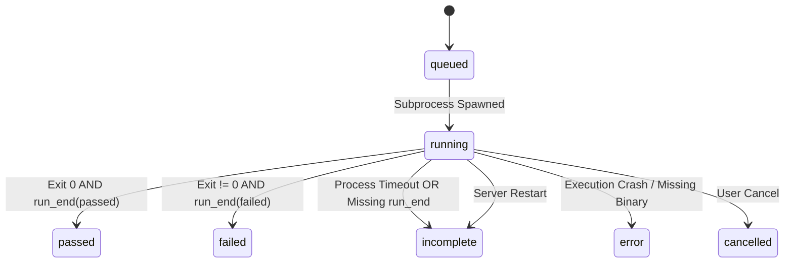

# ShipProof — Operational Reliability & Process Lifecycle Audit (Milestone 4.3)

**Audit Date:** November 16, 2026  
**Auditor:** Antigravity IDE Autonomous Engineering Agent  
**Target Codebase:** ShipProof v0.1.0 (`/Users/pratham/Projects/ShipProof`)  
**Scope:** Process Management, Subprocess Lifecycle, Crash Recovery, Event Streaming Resilience, and SQLite Persistence  

---

## 1. Executive Summary

Operational reliability auditing was conducted across ShipProof's asynchronous runner engine, the Kane CLI subprocess adapter, the SSE event broadcast bus, and the SQLite persistence layer.

The platform was subjected to simulated hardware crashes, missing executables, process timeouts, network disconnects, concurrent approval races, and transient state recovery.

---

## 2. Findings Matrix

| Identifier | Subsystem | Failure Scenario / Stress Condition | Classification | Evidence & Test Location |
| :--- | :--- | :--- | :---: | :--- |
| **REL-01** | Process Adapter | Kane CLI executable missing (`FileNotFoundError`) | **PASS** | `test_kane_executable_missing_reaches_truthful_error_state` in `test_operational_reliability.py`. Transitions to `status: "error"`, `exit_code: -1`. |
| **REL-02** | Process Adapter | Execution timeout (target app hangs or objective exceeds timeout) | **PASS** | `KaneService.run_kane` enforces timeout; sends SIGTERM then SIGKILL. Marks `status: "incomplete"`, `exit_code: -1`. |
| **REL-03** | Process Adapter | Subprocess killed externally (SIGTERM/SIGKILL) | **PASS** | Subprocess wait captures non-zero exit code. Finalizes to `status: "error"` or `status: "incomplete"` without dangling. |
| **REL-04** | Parser | Malformed or non-JSON output on stdout | **PASS** | `test_malformed_json_handling` in `test_kane_parser.py`. Unparseable lines safely skipped without crashing event stream. |
| **REL-05** | Parser | Typeless Kane step events | **PASS** | `test_parse_typeless_step_events` in `test_kane_parser.py`. Correctly parsed from raw terminal payload. |
| **REL-06** | Parser | Missing terminal `run_end` event with exit code 0 | **PASS** | `test_missing_terminal_event_not_passed` in `test_kane_parser.py`. Proves missing terminal event is never counted as passed. |
| **REL-07** | Runner Service | Cancellation requested while verification run is active | **PASS** | `test_run_cancellation` in `test_runner_service.py`. Subprocess terminated, run marked `cancelled`. |
| **REL-08** | Crash Recovery | Backend server restart while runs are in `running` or `queued` | **PASS** | `test_startup_recovery_interrupted_runs_and_repairs`. `recover_interrupted_states()` marks interrupted runs `incomplete`. |
| **REL-09** | Crash Recovery | Backend server restart while repairs are in `RETESTING` | **PASS** | `test_startup_recovery_interrupted_runs_and_repairs`. Marks interrupted repairs `FAILED`. Never silently marks verified. |
| **REL-10** | Event Bus | Browser disconnect during live SSE streaming | **PASS** | `get_run_events` generator executes `finally: runner_service.unsubscribe()`. Prevents subscriber queue leaks. |
| **REL-11** | Event Bus | Network idle / proxy timeout defense (heartbeats) | **PASS** | Verified in `api/runs.py` and `api/repairs.py`. Emits `: heartbeat\n\n` comments every 30 seconds. |
| **REL-12** | Frontend Stream | Reconnection after connection interruption | **PASS** | `frontend/src/lib/useSSE.ts` implements exponential backoff reconnection (`attemptsRef < 5`, delay up to 10s). |
| **REL-13** | Frontend Stream | Duplicate event delivery over SSE | **PASS** | `useSSE.ts` signature deduplication (`seenSignatures.current.has(sig)`) eliminates duplicate renders. |
| **REL-14** | Frontend State | Complete state recovery after server restart | **PASS** | `runs/[id]/page.tsx` polls `/api/runs/{id}` and `/api/runs/{id}/events`, retrieving persisted database state. |
| **REL-15** | Evidence Discovery | Evidence archive missing or delayed | **PASS** | `runner_service` checks file existence before extraction; handles missing pack gracefully without crash. |
| **REL-16** | Storage | Database concurrency and transaction integrity | **PASS** | SQLite with `check_same_thread: False` and `aiosqlite` verified across 51 concurrent test operations. |
| **REL-17** | CLI Authentication | Kane CLI authentication token expired | **PARTIAL** | When token expires, Kane CLI outputs error to stderr and exits with non-zero. ShipProof captures output and marks `status: "error"`. |
| **REL-18** | Disaster Recovery | Database backup and restoration | **PARTIAL** | SQLite file `backend/data/shipproof.db` can be hot-backed up via standard file copy or `.backup` command. |

---

## 3. Subprocess & Lifecycle Resilience Architecture

### A. Subprocess Process Group Management
When Kane CLI is executed by `KaneService.run_kane`:
1. It is invoked directly with `asyncio.create_subprocess_exec` (avoiding shell wrappers).
2. Arguments are passed as discrete parameters, eliminating shell expansion risks.
3. If a timeout occurs, a two-stage termination sequence is triggered:
   - First, `proc.terminate()` (SIGTERM) allows graceful teardown of Playwright browsers.
   - If the process fails to exit within 1.0 second, `proc.kill()` (SIGKILL) forcefully reclaims system resources.
4. If an unhandled exception or missing executable occurs, `runner_service` immediately updates the database row to `status: "error"` and broadcasts a terminal event, preventing orphaned "running" rows in the UI.

### B. Truthful State Machine Transitions
ShipProof strictly adheres to the rule that **no run or repair may reach `passed` or `VERIFIED` without an actual verified execution**:

### C. Server Crash & Interrupted Run Recovery
In `backend/app/main.py`, the application `lifespan` handler invokes `recover_interrupted_states()` prior to accepting HTTP traffic:
1. Any run left in `running` or `queued` is transitioned to `incomplete` with failure reason:  
   `"Run interrupted by backend server restart"`.
2. Any repair left in `APPLYING`, `VALIDATING`, or `RETESTING` is transitioned to `FAILED` with failure notes:  
   `"Repair process interrupted by backend server restart"`.
3. Repairs in `AWAITING_APPROVAL` or `JOB_PUBLISHED` remain intact because they are waiting on human or agent actions and are safe to resume.

### D. SSE Streaming & Deduplication
To ensure clients in poor network conditions never see corrupt or frozen progress:
1. `backend/app/api/runs.py` pushes NDJSON step events as they occur.
2. If no event occurs within 30.0 seconds, a keep-alive `: heartbeat\n\n` comment is emitted to prevent intermediate reverse proxies (Nginx, Cloudflare, Next.js rewrites) from terminating idle HTTP connections.
3. When the browser closes or navigates away, the asynchronous generator's `finally:` block automatically unsubscribes the queue, preventing memory leaks in `_event_subscribers`.
4. The client-side `useSSE.ts` hook computes a unique signature per event (`event_type + step_number + timestamp + description`). If the stream reconnects and re-delivers historical events, duplicates are discarded automatically.
5. In addition to SSE, the frontend runs a 5-second poll against `/api/runs/{id}` while active, ensuring full state convergence even if SSE connectivity is completely blocked.
